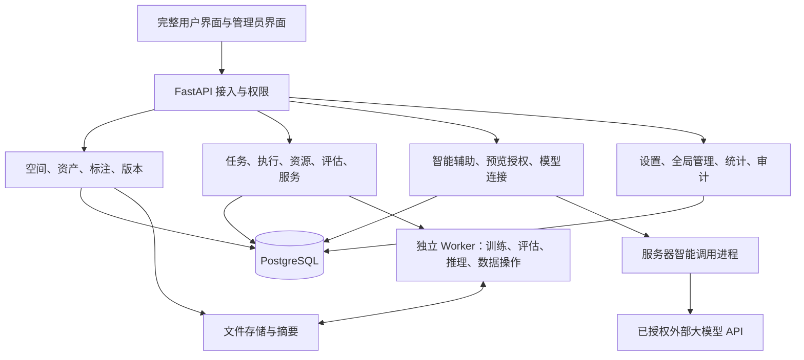

# 设计约定与验收

本文件保留2026-10-29总体设计，各批实际实现及限制见[交接](./实施进度与交接.md)。当前API见[本阶段OpenAPI](./openapi.json)；新增批次先补齐字段、错误码、迁移与契约，再编码。

## 界面恢复

视觉继续采用[已确认模板](../stage4/云管控型前端模板提示词.md)。旧原型的页面布局、组件与交互作为恢复基线，当前后端、Cookie/CSRF及权限校验继续复用。8765原型保留用于对照；真实实现放在 `frontend/live`。

### 各类页面的布局

- 工作台恢复一条汇总区、最近训练表、快捷操作和近期活动。个人工作台显示当前空间，管理员统计显示全平台并可筛选空间，两者分别实现。
- 项目和模型使用目录卡片，支持列表切换。卡片为白色内容区和浅灰底部操作区；标签只放任务、版本、训练方式等短信息。
- 数据、任务、作业、审计使用紧凑表格。筛选直接放在画布上，表格有独立白色区域；多区块页面按业务分区。
- 训练详情恢复概况、指标、日志、产物标签页。评估详情提供结果、错误样本与对比；服务详情提供概况、测试与调用记录。
- 在线标注采用“样本队列｜文本/图片工作区｜标签与审核”布局。窄屏切为上下排列，当前样本及未提交结果在切换布局时保留。
- 简单新增和修改使用弹窗；新建训练保留四步独立页面，数据导入保留文件预览页面。已有列表页不插入新增表单。

例如训练详情恢复后的信息组织为：

```text
任务名称、状态                                      复制配置  停止/重跑
概况  指标  日志  产物
───────────────────────────────────────────────────────────────────
概况：模型/数据版本、资源、配置、执行阶段、结果
指标：实际曲线、轮次筛选、原始指标下载
日志：阶段/级别/关键词筛选、跟随、下载、智能诊断
产物：版本、文件、校验值、来源、创建评估、部署服务
```

### 所有组件使用同一套规则

| 组件 | 固定规则 |
| --- | --- |
| 导航 | 顶栏50px；侧栏208px/收窄64px；分组首次全展开，记住分组与滚动；收窄只留图标，隐藏可见滚动条 |
| 色彩 | 主操作深青绿 `#276d62`；详情链接蓝色 `#1664c0`；正文 `#252525`；画布 `#f4f5f7`；白色内容区；状态用独立语义色 |
| 字体 | 微软雅黑UI/PingFang SC；正文、菜单、表头、标签和操作至少14px；页面标题22px，分区16px |
| 表格 | 标准单行约58px；同类页行高一致；长表格在自身容器滚动；默认名称、版本、邮箱等各有明确字段 |
| 状态 | 列表只显示带语义符号的圆形图标；悬停、键盘聚焦或触控查看中文；详情可显示文字 |
| 控件 | 输入框、按钮、选择框标准32px高、6px圆角，统一焦点/禁用/错误状态；需要搜索时使用可检索选择框 |
| 面板/弹窗 | 面板8px、弹窗10px圆角；普通弹窗约600px，复杂配置约760px；超高内容内部滚动 |
| 文案 | 删除大字加小字、名称下灰色说明与重复导语；短分类用标签；必要的错误、安全提示及字段限制正常字号显示 |

表单错误显示在对应字段或弹窗内，提交中禁用重复操作。刷新列表不打断输入、弹窗、日志阅读与页面滚动。旧版已确认的组件优先复用；共享组件改动需要同时回归旧原型。

## 架构与模块

保持 FastAPI 模块化单体与独立GPU/CPU Worker。新增模块按标注、数据操作、智能辅助、统计、设置、全局管理划分，分别维护路由、输入输出模型和业务服务。前端按页面和公共组件拆分，不把新功能继续堆进 `app.js`、`workflows.js` 或单个千行文件。



长耗时处理保存为可查询任务，复用领取、取消、事件和回执的既有机制；数据任务与训练任务分别维护业务配置。外部模型凭据留在控制服务器，GPU Worker不接收供应商密钥。网络调用由独立操作进程处理，控制端请求只负责鉴权、创建请求和查询结果。

已有HTTPX、数据库、文件存储和Worker机制优先复用。下一批不预先引入Redis、Kubernetes、新前端框架或供应商SDK；确需新增依赖时列明具体范围，再按环境约定安装。

### 需要补充的数据

| 对象 | 保存的信息 |
| --- | --- |
| 平台设置、空间辅助策略 | 注册/邀请开关、任务与上传限制、空间允许的供应商/用途、调用额度、版本号 |
| 模型连接 | 供应商地址、模型名、文本/视觉/结构化输出能力、启用状态、私有凭据引用 |
| 智能请求与采纳记录 | 用途、原始对象/版本、脱敏预览摘要、确认人、模型配置快照、状态、结果、token用量、采纳目标 |
| 标注批次与结果 | 源数据版本、样本标识、标签、分配、草稿、审核状态、人工/智能来源、发布版本 |
| 数据操作 | 源版本、清洗/划分/增强规则、固定种子、事件、取消、输出摘要和新版本 |
| 监控采样与资源用量 | 节点/设备、采样时间、利用率、显存、任务和实际占用时长 |
| 存储计量与版本来源 | 文件大小、唯一物理文件、空间/归属、引用、父版本与操作来源 |
| 现有对象的增量字段 | 项目说明/归档、资产分类/归档、密钥最近使用、结构化错误与失败阶段等 |

配置和可编辑元数据沿用 revision/ETag。训练已提交快照、数据版本与模型产物保持不可变。新表和增量字段使用显式迁移，在空库与旧版本升级上分别验证。

## API增量草案

继续沿用 `/api/v1`、工作空间作用域、统一分页/错误结构和Cookie/CSRF。管理员全局接口单独校验管理员身份及相应动作，不依赖前端传入空间列表拼成“全局”。

| 能力 | 草拟资源与操作 | 开发前需要固定 |
| --- | --- | --- |
| 概览和统计 | `GET /workspaces/{w}/overview`、`GET /admin/statistics` | 时间范围、指标定义、时区与权限 |
| 全局管理 | `GET /admin/datasets`、`/admin/models`、`/admin/jobs`、`/admin/audit` | 空间、成员、状态、任务种类与时间筛选；受控详情及操作 |
| 标注 | 工作空间下的 `annotation-batches`，样本结果保存、分配、审核、发布 | 样本ID、修订冲突、标签与输出格式、发布前检查 |
| 数据处理/增强 | 工作空间下的 `data-operations`，创建、查询、事件、取消、发布版本 | 操作白名单、版本摘要、幂等、结果文件与错误 |
| 智能辅助 | 工作空间下 `assistant-previews` 与 `assistant-requests`；预览确认、查询、取消、采纳 | 三种用途、脱敏摘要、用途授权、结构化结果、模型能力与额度 |
| 模型连接和设置 | 管理员的 `model-connections`、连接测试和 `settings`；空间辅助策略 | 凭据仅写、脱敏返回、地址校验、能力验证与配置revision |
| 资源监控和授权 | 现有节点接口增加采样、授权、配额/用量、执行核查资源 | 采样频率/保留、设备范围、权限来源、核查证据和操作幂等 |
| 结果与服务 | 项目/评估对比、日志/报告/样本下载、服务调用记录、密钥轮换 | 固定评估口径、下载鉴权、脱敏、文件归属及频率限制 |
| 账号与协作 | 当前用户资料/密码、成员移除、邀请注册、管理员密码重置 | 邀请有效期、组与空间归属、会话撤销、最后管理员和所有者保护 |

这里只固定接口资源方向；完整字段、响应、错误、权限矩阵及示例在对应批次实现前发布。已有接口能满足的操作直接复用。

## 统一业务规则

1. 普通用户按空间权限访问；管理员可进入全局视图并按空间筛选。管理员写操作仍需动作权限，用户明确禁用的权限优先。
2. 继续采用组基础授权、个人追加或禁用；个人额度按现行组与个人上限合成。新增的组共享总预算单独建字段，默认未设置，不悄悄把现有每人上限改成组内总量。
3. 配额在任务领取与文件写入时由服务器实际检查。GPU、并发和存储区分上限、预留、已用；撤销权限不伪造运行任务的停止回执。
4. 新增数据、清洗、增强和标注发布都生成新版本。训练/评估引用固定版本与摘要，文件删除先做引用检查；归档不删除历史执行所需文件。
5. 训练数据、验证数据和独立测试数据有明确用途。拆分记录种子和来源，增强只处理训练分区；对比引用相同评估版本和指标口径。
6. 智能调用先检查空间授权、用途与模型能力，随后预览脱敏内容。确认与预览摘要绑定；内容或来源版本变化须重新预览。未经确认不外发项目内容。
7. 智能候选经结构校验和人工采纳后写入草稿或新版本。参数建议不改运行中训练，日志建议不执行任意命令。模型返回的自由文本不作为工具调用指令。
8. 排队取消进入已取消；派发后停止先进入停止中，收到进程退出与回执后进入已停止并释放占用。失联保留占用；安全回收需要核查旧进程并防止旧执行再次领取或回传覆盖。
9. 文件操作使用受控路径与格式校验。模型导入仅支持已实现训练器可加载的格式，不执行上传的Python代码。样本、原始日志和供应商凭据不进入普通审计导出。
10. 注册默认采用内部邀请，公开注册保持关闭；管理员配置邀请所属组、空间、有效期和基础额度。该策略随整体计划确认后生效。

### 故障与恢复

| 阶段 | 至少覆盖的情况 | 页面与恢复行为 |
| --- | --- | --- |
| 导入/处理 | 格式或标签错误、重复上传、解析失败、配额不足、输出写入失败 | 返回样本/字段定位和校验报告，未发布版本不进入训练列表 |
| 标注/审核 | 样本被占用、修订冲突、标签变化、发布时有未审核样本 | 保留草稿，提示冲突；发布校验通过后才生成固定版本 |
| 智能调用 | 未授权、预览变化、密钥/余额/限流、超时、输出结构错误、部分批次失败 | 分别记录原因；人工流程可继续；重试避免重复外发及重复采纳 |
| 准备/训练 | 无合适设备、额度不足、文件缺失或摘要不符、运行时不兼容、OOM、训练异常 | 标出阶段、错误码、真实日志和资源；新草稿可带入修正参数 |
| Worker失联 | 心跳中断、重启回执、执行身份冲突、子进程状态不明 | 保留占用、暂停新领取、显示待核查；有退出证据后才回收 |
| 结果/推理 | 产物上传失败、模型加载失败、服务未就绪、预测超时、密钥到期/撤销 | 区分阶段和状态，回传幂等；调用失败可查询，服务停止后不再接受新请求 |

## 验收与发布

每批先验证对应业务，再跑相关回归。当前63项后端和85项前端为stage12最近验收基线；本轮规划未重复执行，也不把这些旧测试算作新功能验证。

界面逐页在1440、1024、390三种宽度检查；20个菜单至少60个布局组合。对四步向导、导入、标注、权限、接入、外发预览与采纳另做实际操作检查，逐个核对字号、选择框、长名称、状态提示、焦点和滚动位置。

核心业务验收包括跨空间越权、个人禁用、组总预算并发、存储边界与重复回执、版本不可变、预览确认失效、模型输出不合规、三类真实训练、固定数据评估、服务密钥轮换及失联核查。PostgreSQL并发使用独立测试库；多个Worker验证需事先核对可用机器，不用模拟结果替代。

外部模型测试分协议测试和真实调用：前者覆盖请求、超时、重试、结构校验和审计，后者验证实际供应商返回与人工采纳。没有可用连接、视觉能力或余额时对应真实验收继续标记待完成。

每次发布前在服务器备份数据库、文件和私有配置，备份按既定决定仅留服务器。新版本使用独立发布目录，先校验迁移和兼容性，再切换；运行中任务和Worker协议需要兼容或安排明确交接。完成后交付可点击网页、截图、验证步骤、实际结果与已知限制。

## 参考与采用

工作台、目录、标签页和控件以项目已确认原型为主要依据。补充参考只用于完善业务组织，不引入额外框架或部署平台。

- 标注的候选、人工结果和导出关系参考 [Label Studio标注流程](https://labelstud.io/guide/labeling)与[预标注导入](https://labelstud.io/guide/predictions)。本项目采用人工复核后发布固定数据版本。
- 项目内记录参数、指标、数据与产物、比较多次实验的组织参考 [MLflow Tracking](https://mlflow.org/docs/latest/tracking/)。本阶段沿用自有后端实现。
- 训练创建的配置分组与失败后复制新任务参考 [PAI训练任务](https://help.aliyun.com/zh/pai/create-a-training-task)和[训练失败定位](https://help.aliyun.com/zh/pai/faq-about-dlc)。页面外观继续使用已确认的本平台配色和组件。
