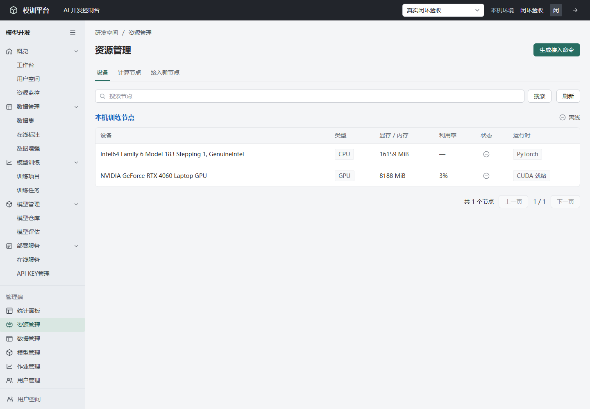
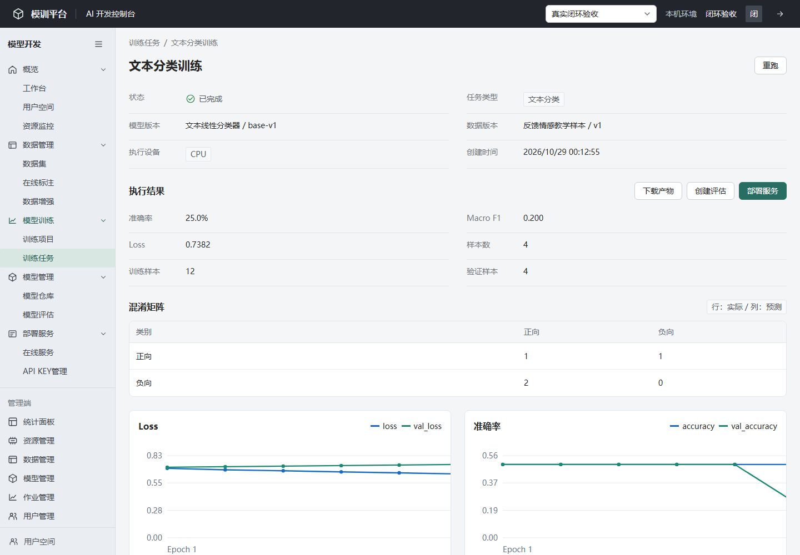
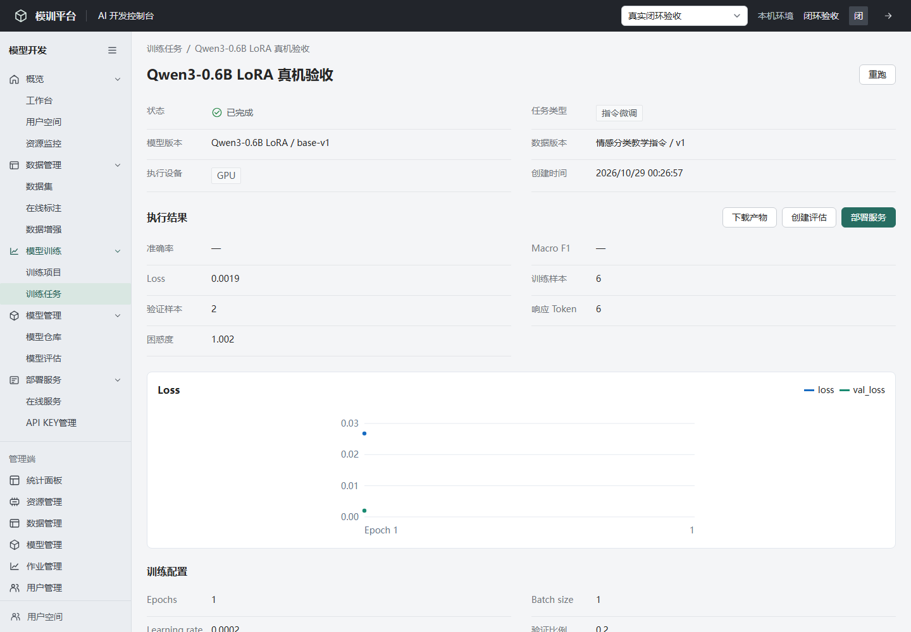
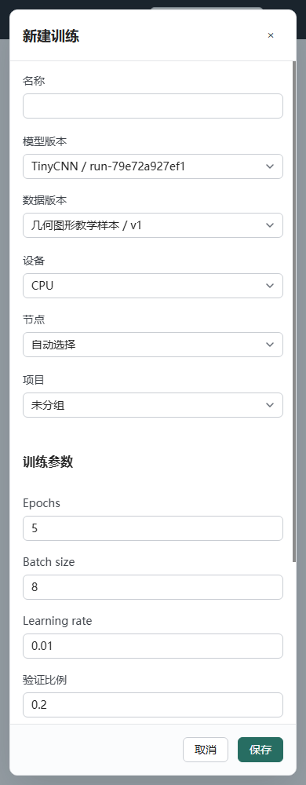

# 真实资源与训练页面

图片来自本机8001独立验收库，样本和账号为验证数据；使用真实Worker和真实计算结果。8000的“北航跳动”空间另有实际演示任务，二者数据独立。

资源清单：

文本训练和真实指标：

Qwen LoRA结果：

手机新建训练：

[浏览器检查记录](./browser-audit.json)。完整原始记录位于D盘training-flow-20261029-01，包含页面提交训练、部署服务和返回真实预测的截图。教学样本的分数只用于检查计算和流程，不代表业务模型质量。
