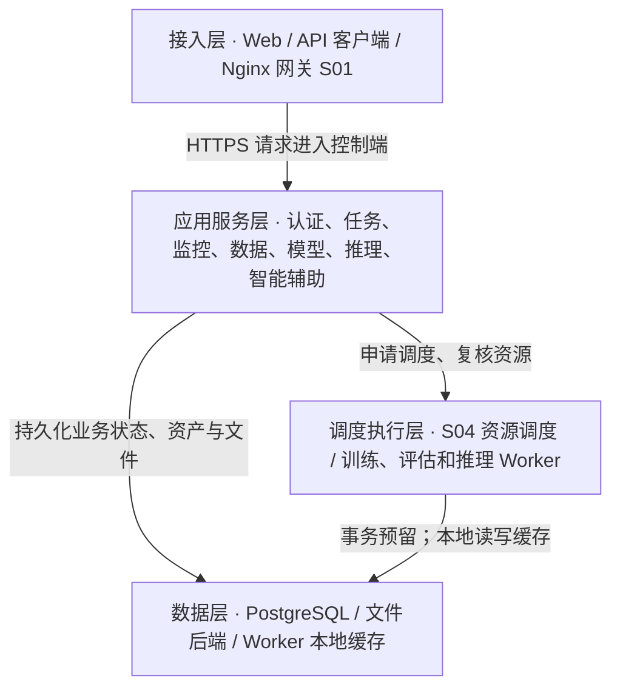
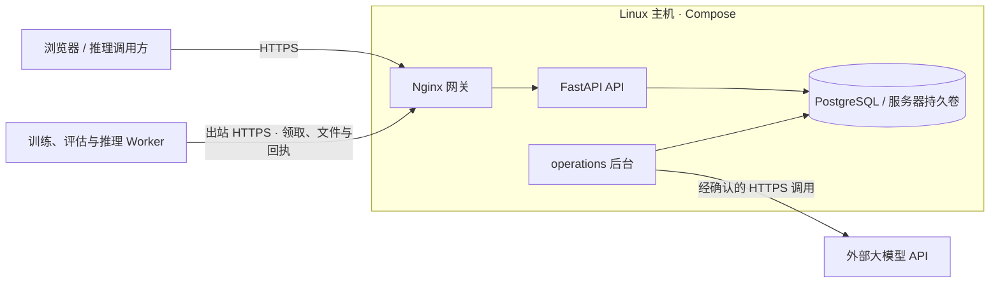

# 大模型集成训练平台

## 系统架构设计说明书

> V1.0 · 2026 年 11 月 11 日 · 目标架构与实施基线

面向企业和开发团队的内部训练平台。团队在工作空间内管理数据、模型与算力，从训练配置一路完成评估和推理发布。训练经验较少的成员可使用智能标注、参数建议和日志解释；拥有权限的成员负责审核、发布和治理。

**采用方案：四层逻辑架构，模块化控制端，独立后台与 Worker。** 控制端同版发布；各类计算按设备能力接入。部署可从一台 Linux 主机起步。

### 阅读索引

| 部分 | 内容 |
| --- | --- |
| 01 范围与实施基线 | 服务对象、技术选择、已实现与待实施能力 |
| 02 逻辑架构 | 四层职责、依赖方向、进程关系 |
| 03 服务划分 | 九个构件的职责、数据归属、通信与运行位置 |
| 04 任务与算力 | 提交、调度、执行、失联和停止 |
| 05 推理与智能辅助 | 模型发布、在线调用、外部大模型与人工审核 |
| 06 数据与治理 | 资产版本、存储与缓存、权限、备份 |
| 07 部署拓扑 | 默认部署、信任边界、可选云部署与扩容 |
| 08 质量属性与验证 | 指标口径、关键验证场景、需求追踪 |
| 09 关键架构决策 | 选项、决定、代价及实施顺序 |

<!-- page -->

## 01 范围与实施基线

### 系统边界

**开发成员**在工作空间内导入或登记资产、配置训练、查看日志、评估结果及发布服务。**管理员**管理用户和组、设备接入、权限、配额、审计及外部模型连接。**应用调用方**使用获授权的推理 API Key。三类主体共用平台入口，各自使用独立的凭据和授权范围。

一期覆盖文本分类、图像分类与小型 Qwen LoRA。获授权成员可在页面维护数据集、模型和版本，模型关联平台已支持的训练器。模型或数据登记与训练器接入独立演进。真实训练按**单任务单节点**设计，GPU 任务默认单卡；多个节点可并行执行不同任务。

### 部署选择

控制端采用 Python／FastAPI，业务按模块组织。Web API 和 `operations` 后台同版发布、分进程运行，使用 PostgreSQL 统一保存状态。Nginx 对外提供 HTTPS，Worker 按版本化协议连接。开发联调可使用 SQLite；领取竞争和事务一致性以 PostgreSQL 验证为准。

保留任务状态、配额核验和设备预留的事务边界。数据处理和大模型调用在后台推进；训练与在线推理在 Worker 执行。内部模块通过明确接口协作，当前部署不拆微服务，也不依赖消息代理或 Kubernetes。

### 能力状态

| 状态 | 能力与边界 |
| --- | --- |
| 已实现 | 登录与工作空间、资产版本、数据处理、训练及评估、推理调用与 API Key、设备接入、配额与审计。线上入口采用 Compose。三项智能辅助已有合成输入调用记录。 |
| 已有实机记录 | 既往验收包括一次跨机 CUDA 训练，以及云端双 CPU Worker 容器完成训练、评估和服务。双容器共用一台主机；完整多物理机并行、视觉供应商和长期恢复仍需专项验证。 |
| 已选定的下一步 | 训练／评估与推理设备用途隔离、排队原因与匹配优化、文件传输边界。现有设备共享，独立推理资源池尚未上线。 |
| 可选扩展 | OSS、缓存感知调度、Mock 资源、真实同任务多卡／多节点、Agent 工具与记忆。按各自验收条件启用。 |

本文以已验收的 `20261101-15a` 为实施基线。下文未标为现行能力的设计，按发布和验收记录确定落地状态。

<!-- page -->

## 02 逻辑架构

四层描述系统的职责和依赖。控制端管理任务与权限；执行节点消耗算力；数据层保存可恢复的权威状态和文件。服务的逻辑划分与进程、主机划分分别表达。

<!-- figure: logic -->

| 层 | 职责与边界 |
| --- | --- |
| 接入层 | 提供 Web、版本化业务 API、推理和 Worker 入口。网关终止 TLS、转发请求；对象权限在控制端判定。 |
| 应用服务层 | 维护身份、任务、资产、监控、推理和智能辅助。短请求同步返回；耗时操作先持久受理，再由后台或 Worker 执行。 |
| 调度执行层 | 选择节点与设备，核验额度并原子预留；Worker 加载输入、执行及回传。远端 Worker 只通过授权 API 访问控制端。 |
| 数据层 | PostgreSQL 保存元数据、状态与事件；文件后端保存数据和模型；Worker 磁盘缓存可重建内容。业务数据库只由控制端写入。 |

### 开发与运行视图

`frontend/live` 提供控制台；`backend` 包含 API、服务模块、数据库和后台入口；`worker` 包含节点探测、客户端、执行器和训练器。API 与后台共享构件契约，后台读取持久待办。网关、API、后台和 Worker 分进程；训练子进程与常驻推理进程由 Worker 管理。事件和对象引用携带工作空间、任务或执行身份，供故障定位和重放核对。

<!-- page -->

## 03 服务划分与通信

S01–S08 是核心逻辑服务，S09 为智能辅助。表中的数据归属表示由哪个模块定义并维护业务规则；同一 PostgreSQL 内允许通过明确的业务接口协调事务。

| 构件 | 责任与数据归属 | 契约与运行位置 |
| --- | --- | --- |
| S01 API 网关 | HTTPS、路由、入口保护 | Nginx 独立进程；区分用户、公开推理和 Worker 路由，转发控制 API。 |
| S02 认证与权限 | 用户、角色、组、空间授权和会话 | 控制 API；业务操作同步鉴权，领取和应用建议时重新检查。 |
| S03 任务 | 项目、任务、配置快照与业务状态 | 控制 API；提交、查询、停止和重跑。通过 S04 申请资源，与 S07 核对产物。 |
| S04 资源调度 | 节点、设备、执行尝试、预留与租约 | 调度决策在控制 API。Worker 主动领取、发心跳、取停止指令和回报。 |
| S05 监控 | 训练事件、指标、设备遥测与日志 | 控制 API 采集及查询；前端轮询与增量读取。训练终态由 S03 裁决。 |
| S06 数据 | 数据集、样本、版本、校验及标注记录 | 控制 API 受理上传、预览和发布；`operations` 执行清洗、去重和划分。 |
| S07 模型仓库 | 模型模板、版本、权重引用、产物与发布记录 | 控制 API；归档校验、版本登记和授权读取，文件存入文件后端。 |
| S08 推理 | 服务登记、调用记录和 API Key | 控制 API 鉴权并异步受理，推理 Worker 领取调用和返回结果。 |
| S09 智能辅助 | 供应商连接、外发策略、候选与采纳记录 | 控制 API 管理预览与确认；`operations` 经 HTTPS 调用外部模型。 |

### 对外接口分组

| 对象 | 接口与访问方式 |
| --- | --- |
| 浏览器与管理员 | `/api/v1`：同源会话、状态查询、资产与管理操作；修改操作使用 CSRF 校验。 |
| 计算节点 | `/api/worker/v1`：接入、心跳、领取、事件、文件和推理回执；凭节点身份和执行归属授权。 |
| 推理调用方 | `/api/inference/v1`：限定服务的 API Key；请求异步受理，按调用 ID 查询结果。 |

长操作先返回标识。任务状态按已确认的执行事实更新，产物校验后可用。迟到的日志和指标可以补记，不覆盖已确认的终态。

<!-- page -->

## 04 任务调度与 Worker 执行

### 从提交到归档

1. **受理。** 校验用户、空间、项目、资产版本和参数。任务快照固定训练器、模型及数据版本、输入摘要、资源要求与配置。修改配置或重跑时保留原任务记录。
2. **匹配。** Worker 上报节点、设备、显存和运行时能力。控制端按授权、配额、设备用途、兼容性、在线状态和占用判定资格；匹配任务按优先级、提交时间排序。目标设计将明确的设备条件前移，避免大量不兼容任务挡住后排可执行任务。
3. **预留。** Worker 调用领取接口；控制端在一个 PostgreSQL 事务内核验额度、建立执行记录、锁定设备并更新状态。重复领取可返回原执行。设备按节点与设备 ID 识别，调度适配不绑定云供应商。
4. **执行。** Worker 核验输入摘要，使用受控训练器启动子进程；发心跳，按执行 ID 与事件序号回传状态、指标和日志。当前匹配实现覆盖已验证的 CPU／CUDA 运行时。
5. **归档。** 先核对退出事实和必要文件，再确认成功。登记产物引用后可发布模型版本、提交评估或创建推理服务。评估固定模型与测试集版本，按统一指标比较。

### 故障与停止

| 情况 | 系统处理 |
| --- | --- |
| 排队取消／运行停止 | 未启动任务确认撤回后为已取消；已启动任务进入停止中，Worker 确认退出和清理后为已停止。正常完成若已确认，保留原终态。 |
| Worker 失联 | 停止新派发并保留原占用，允许原执行重连补报。未知进程状态进入人工核查；回收后才可启动新的执行尝试。 |
| 输入、环境或计算失败 | 记录失败阶段和原始证据，结束进程后核对资源释放。用户可按原快照或新配置重跑；有兼容检查点时才提供续训。 |
| 产物上传失败 | 保留已生成的本地文件，记录可重试的传输故障。重传后重新校验，避免为一次传输故障直接重训。 |

本地 CPU、远端笔记本 CPU／GPU 和 Linux 服务器 GPU 使用同一接入协议。管理员审核节点后启用接单；暂停、撤销或失联节点停止领取新任务。模拟资源作为独立演示模式，标识贯穿页面与统计，不向真实 Worker 派发，不登记真实产物。

<!-- page -->

## 05 推理与智能辅助

### 在线推理

发布时固定模型版本、权重引用和推理配置。服务任务由兼容 Worker 领取，模型完成加载并回报就绪后才能接收调用。外部调用经 API Key 鉴权，控制端保存调用记录并返回调用 ID；Worker 主动获取请求、执行并回传结果。停止时先拒绝新请求，处置在途调用，核对进程退出后释放设备。

资源用途计划分为**共享、训练评估、推理专用**。旧记录按共享解读；有活动预留的设备不得改用途。严格隔离启用后，仅使用相应用途的设备。设备隔离与并发额度分别核验：训练占满全局或组额度时，新推理仍可能等待；是否预留并发名额，由共载验收决定。对推理分别记录发布等待、模型预热、调用排队和执行时延。

对于 Qwen 分类服务，发布配置固定标签集合，Worker 按合法标签约束生成，控制端再校验输出。生成式配置和分类配置分开管理，调用方可以明确知道响应类型。

### 智能辅助

| 功能 | 输入和输出 | 人工控制 |
| --- | --- | --- |
| 智能标注 | 选定样本与标签规范 → 候选标签 | 检查格式、标签与样本版本；审核后生成新数据版本。图像输入需匹配视觉能力。 |
| 智能参数 | 训练器约束、数据摘要与设备能力 → 候选配置 | 复核范围、依赖与版本；采纳后创建新配置，运行中的任务保持原快照。 |
| 智能日志 | 选定范围的脱敏日志 → 解释、证据定位和建议 | 区分日志事实与模型判断；诊断建议由用户决定是否处理。 |

外发默认关闭。管理员配置模型连接；工作空间明确授权后，用户预览脱敏内容并确认发送。后台调用设置超时和限流；供应商失败只结束辅助请求，人工路径可继续。候选须经过结构和业务规则校验。授权、确认、调用和采纳均记录审计。

后续 Agent 复用现有受控接口，先开放只读查询与建议工具。写入配置、数据版本或提交新任务仍经权限核验和用户确认。记忆按工作空间隔离，设保留与删除策略；工具权限和记忆当前均属扩展设计。

<!-- page -->

## 06 数据、存储与安全治理

### 数据归属与生命周期

| 数据 | 权威位置 | 管理规则 |
| --- | --- | --- |
| 用户、空间、权限、任务和执行 | PostgreSQL | 外键及事务保持引用一致；审计保留主体、动作、对象、结果和关联 ID。 |
| 数据集、模型和产物版本 | PostgreSQL 记录归属、来源、对象键、大小及摘要；文件后端保存内容 | 校验后发布；训练固定不可变版本。清洗、划分、标注和模型发布生成版本。归档不破坏历史任务读取。 |
| 临时输入、模型缓存和检查点 | Worker 本地盘 | 缓存按摘要命中并校验，运行期间保护引用。正式产物回传；需跨机恢复的检查点须经授权归档。 |
| 事件、日志、指标 | 控制端持久化 | 以执行身份与序号关联。批量写入及保留策略按负载调整；导出仍检查空间权限。 |

**默认文件路径：** 浏览器上传至控制端，控制端写服务器持久卷；Worker 经执行授权下载并回传产物。已有摘要缓存继续使用，通用文件传输有 64 MiB 限制。大文件演进先统一读写、流式校验与失败清理，再根据实测的传输量、回源次数和准备时间优化缓存调度。

**可选 OSS 路径：** 由部署启用私有桶，控制端签发限时、限对象、限操作的授权。客户端按需要分片上传或直接下载；服务端验摘要后登记。切换存储前先迁移和校验对象引用，再切读写配置并留回退点。未启用时，默认路径可完成全流程。

### 权限与恢复边界

工作空间是业务访问边界。用户组提供基础授权，个人可追加或显式禁止；显式禁止优先，组与个人额度取较严约束，组共享用量另行核算。对象级鉴权覆盖读取、下载、调用、导出和写入。节点凭据、会话与推理密钥用途分离，支持撤销或轮换。数据库仅在应用网络可达，密钥和原始业务内容不进入普通日志。

备份将数据库与文件清单对齐，恢复后校验权限、任务快照和对象摘要。已有备份用于同一服务器内的恢复；整机丢失恢复需独立备份位置和演练证据。恢复过程核对失联执行与设备占用，再开放新任务领取。

<!-- page -->

## 07 部署拓扑与扩容

<!-- figure: deployment -->

默认部署由一台 Linux 主机运行 Nginx、FastAPI、`operations` 与 PostgreSQL，迁移步骤在应用启动前执行。应用连接数据库和持久卷；数据库无公网端口。Worker 可分布在不同网络，只需连接 HTTPS 网关。启用 OSS 后，授权数据经客户端与私有桶直接传输；业务状态与版本登记仍经过 API。

| 部署方式 | 组件位置与数据路径 |
| --- | --- |
| 默认 Compose | 公网 HTTPS → Nginx → API；API 与后台访问应用网络内 PostgreSQL 及持久卷。适合单控制主机。 |
| 华为云参考部署 | 公网 ELB → 应用子网 ECS（Nginx、API、后台）；ECS 经私网访问数据子网 RDS PostgreSQL，并经授权访问私有 OBS。ECS 为基线映射，CCE 是另行评估的容器编排选项。外部 Worker 使用原协议；该拓扑未部署验证。 |
| 有需求时扩容 | 先增加合规 Worker 或推理设备。API 多副本前核对共享会话、统一文件访问、数据库连接预算与并发领取。监控和后台按观测调整批量、并发或进程配置。 |

发布先在隔离环境核对数据库迁移、旧任务及 Worker 兼容。数据库前移后使用兼容应用回退，保留业务新记录。旧版本不了解新设备用途时，回退期间暂停新派发。控制端短时中断允许原 Worker 保留现场并重连核对，不以超时推断旧任务已停止。

<!-- page -->

## 08 质量属性与验证

目标以典型团队使用场景制定。对照时固定版本、硬件、输入规模和并发；报告 P50、P95、错误率及环境。下列数值是设计目标，需独立测量。

| 场景 | 目标与验证方法 |
| --- | --- |
| ASR-01 提交与查询 | 20 个活跃会话、3 个在线 Worker 且有后台负载：受理 P95 ≤ 1 秒，任务列表 P95 ≤ 500 毫秒。不计大文件上传与资源等待。重复提交只受理一次。 |
| ASR-02 断网与抢占 | 远端执行中断网，失联检测目标 ≤ 60 秒；保留未知执行预留。双 Worker 竞争不重复分配，原执行可重连补报。 |
| ASR-03 文件完整性 | 上传中断可明确重传，可选分片模式只补缺失段；摘要不符不发布，跨空间未授权读取为零。 |
| ASR-04 推理共载 | 训练开启与关闭使用相同模型、设备和热实例，推理 P95 退化目标 ≤ 20%。分别记录新服务发布等待及已就绪服务调用。 |
| ASR-05 外部模型失败 | 超时或非法输出可追踪，人工流程可继续；无授权或未确认时外发为零。采纳创建新配置或版本。 |
| ASR-06 恢复 | 以 RPO ≤ 24 小时、RTO ≤ 2 小时为目标，演练数据库和文件同点恢复。服务器内恢复与整机丢失恢复分别验收。 |

### 需求到构件的追踪

| 业务场景 | 构件与关键证据 |
| --- | --- |
| IX01–IX06、IX18：训练提交、派发、停止、失联及节点接入 | S02/S03/S04；验证授权、快照、设备预留、队首匹配和回执幂等。 |
| IX07–IX11、IX15：数据、观测、产物和评估 | S05/S06/S07；验证权限、版本、日志游标、摘要和固定评估条件。 |
| IX09、IX12–IX14：标注、连接、日志和推荐 | S09；验证外发授权、人工复核和新版本生成。 |
| IX16–IX17：推理发布和停止 | S04/S08；验证就绪检查、调用鉴权、负载隔离及设备释放。 |

专项回归至少包括：队首 200 条不兼容任务后的可执行任务、同一设备的并发领取、停止与完成竞争、Worker 断网重连、损坏文件拒绝发布、旧客户端与旧资产版本读取。

<!-- page -->

## 09 架构决策与实施顺序

| 决策 | 背景和选项 | 采用方案与后果 |
| --- | --- | --- |
| ADR-01 控制端组织 | 比较模块化同版发布与按业务域独立服务。任务受理、授权和资源需要一致性，小团队希望降低运维成本。 | FastAPI 模块化单体，API、后台、Worker 按负载运行。减少跨服务调用与数据补偿；共享数据库和发布节奏，须控制模块依赖和连接预算。 |
| ADR-02 任务领取与失联 | 远端节点网络不稳定；比较控制端推送、独立消息代理和数据库持久领取。 | Worker 主动拉取，状态与预留同事务；失联保留资源待核查。对弱网友好，未知执行会暂占额度，需观测等待时间并提供核查流程。 |
| ADR-03 存储与传输 | 文件跨机传输有成本；比较服务器持久卷与私有对象存储。 | 元数据和文件分开，默认持久卷，Worker 按摘要缓存，OSS 可选。默认部署简单；容量、备份和大文件边界需要专项维护。 |
| ADR-04 推理隔离 | 在线推理与长训练共享设备会竞争；比较共享设备和专用池。 | 支持推理专用设备，旧设备兼容共享。推理获得设备边界，专用容量可能闲置；并发预算是否预留看共载结果。 |
| ADR-05 外部智能辅助 | 需要模型建议，同时保留内部资产、日志与变更权限。 | 空间授权、脱敏预览、人工确认外发，结果经校验和人工采纳。增加审核步骤，供应商失败可独立降级到人工流程。 |

### 实施顺序

1. **推理设备用途。** 统一资源选项、提交和领取规则；先用兼容模式保护存量设备和服务。验收训练与推理并行、修改与领取竞争。
2. **调度与资源观测。** 改善候选筛选，明确排队原因和节点视图，复核 PostgreSQL 并发、弱网恢复及指标的采样口径。
3. **文件与一期验收。** 统一版本文件接口，测量准备时间和传输量；用默认部署验收三条训练路线及评估、发布和辅助流程。OSS、真实多机和异地恢复各自取证。
4. **按需扩展。** 新训练器通过版本化契约接入。同任务多卡须增加成组预留、启动屏障与整体恢复。Agent 和模拟执行各自按权限与资源边界验收。

新增复杂部署以前，先验证扩充 Worker、进程隔离、队列优化和数据库调优的收益。若约束发生变化，再以相同场景复评架构选型。
