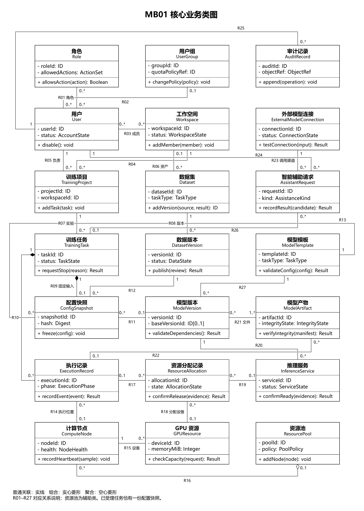

# 大模型集成训练平台核心业务对象与类模型说明

版本 1.0　2026-10-19

## 1 分析范围与对象识别

平台围绕数据准备、模型选择、训练提交、资源调度、过程监控、产物登记、评估和推理提供业务支持。静态模型识别二十个核心对象，并以辅助对象说明授权、数据处理、运行证据、智能建议和恢复记录。核心类图展示这些对象之间的主要关系。

对象识别结合需求中的业务名词与用例事件流：具有独立身份、业务状态或需要长期追溯的概念保留为对象；可重复使用的模型和数据按资产与版本分离；任务配置、实际执行与资源占用分别记录。前端、调度器、任务服务等协调职责在交互模型中表达。

训练项目组织多次实验，训练任务固定一套已受理配置，执行记录追踪一次实际派发。通过这一划分，参数修改、内部传输重试、用户重跑和检查点恢复可以分别说明，历史配置及结果保持可追溯。文本、视觉及表格任务由模型模板和数据契约表达，具体执行能力按接入结果登记。

## 2 核心业务对象清单

下表给出核心职责和关键属性含义。ID 表示稳定业务标识，Ref 表示受控对象引用；集合、状态和契约类型按业务含义描述，物理存储类型在后续设计中确定。

| 业务对象 | 核心职责 | 关键属性说明 |
| --- | --- | --- |
| O01 用户；User | 代表操作主体及账号状态 | userId 为稳定主体标识；account 用于登录；status 决定账号是否可发起操作；primaryGroupId 表示当前主组，允许尚未分组。 |
| O02 角色；Role | 表达职责和允许操作 | roleId 标识职责角色；name 是角色名称；allowedActions 表达该角色允许的操作集合。角色与用户可多对多关联。 |
| O03 用户组；UserGroup | 提供基础授权及组上限 | groupId 标识用户组；name 用于展示；grantRefs 引用基础授权；quotaPolicyRef 引用组上限。组权限与资源池分别管理。 |
| O04 工作空间；Workspace | 组织成员与业务资产 | workspaceId 限定资产的业务空间；name 为名称；memberRefs 记录成员及访问资格；status 决定空间是否可操作。 |
| O05 训练项目；TrainingProject | 组织多次训练和结果比较 | projectId 是项目标识；workspaceId 指明唯一所属空间；name 为名称；ownerId 为负责人。一个项目组织多次训练。 |
| O06 模型模板；ModelTemplate | 定义网络、任务、参数契约与执行能力 | templateId 标识模型执行模板；taskType 描述任务种类；supportedModes 表示支持的训练方式；parameterContract 定义参数类型及范围；runtimeRequirements 描述环境和设备要求。 |
| O07 模型版本；ModelVersion | 提供确定权重或适配器及来源 | versionId 标识确定的权重或适配器；entryId 组织同模型版本；templateId 标识解释执行方式；artifactRefs 引用文件；baseVersionId 保留 LoRA 等基础依赖；sourceExecutionId 可为空，支持导入模型。 |
| O08 数据集；Dataset | 组织同一数据资产的版本 | datasetId 标识数据资产；name 为名称；taskType 表示适用任务；visibility 说明可见范围。版本按数据集归档并受所属空间或公共可见策略控制。 |
| O09 数据版本；DatasetVersion | 固定样本、标签、划分与来源 | versionId 标识固定版本；datasetId 为所属数据集；parentVersionId 保留处理来源；schema 定义字段和标签；manifest 固定样本；splitRef 固定划分；checksum 用于完整性核对；status 表达可用性。 |
| O10 训练任务；TrainingTask | 表示一次固定配置实验及其业务结果 | taskId 表示一次业务实验；projectId 为所属项目；ownerId 为提交主体；taskType 约束可用模板；status 表示业务状态；submittedAt 记录平台受理时间；priority 用于排序；sourceTaskId 保留重跑来源。 |
| O11 配置快照；ConfigSnapshot | 固定一次受理的完整输入 | snapshotId 标识受理输入；templateId 指定模板；initialModelVersionId 与随机初始化标记互斥；datasetVersionId、splitRef 固定数据；runtimeRef 固定环境；parameters 和 resourceRequest 固定超参与资源约束；hash 用于内容核对。 |
| O12 执行记录；ExecutionRecord | 跟踪实际派发、启动、事件与结束 | executionId 区分实际派发尝试；taskId 关联任务；attemptNo 记录次序；nodeId 或 providerExecutionId 标识执行位置；phase 表示准备、训练或上传阶段；startedAt、finishedAt 记录真实执行时间。 |
| O13 计算节点；ComputeNode | 表达可接单 CPU/GPU 节点及运行能力 | nodeId 稳定标识接入节点；source 说明本机、实验室或托管来源；runtimeCapabilities 记录 CPU/GPU 与环境能力；lastHeartbeatAt 表示末次心跳；health 表示审核和健康状态。 |
| O14 GPU 资源；GPUResource | 表达具体设备的能力和占用 | deviceId 是跨节点稳定设备标识；nodeId 指明唯一所属节点；localIndex 仅为节点内显示编号；memoryMiB 明确显存单位；capabilities 描述设备能力；allocationState 表示占用。 |
| O15 资源分配记录；ResourceAllocation | 跟踪预留、占用、释放与清理 | allocationId 标识一次资源分配；ownerKind、ownerId 指向执行或推理服务，二者恰选其一；nodeId、deviceId 定位资源，CPU 分配可无 GPU；quantity 表示用量；state、reservedAt、releasedAt 跟踪生命周期。 |
| O16 模型产物；ModelArtifact | 保存模型文件、检查点及校验结果 | artifactId 标识文件产物；sourceExecutionId 保留本平台执行来源，导入产物可为空；kind 区分最终权重、适配器和检查点；locationRef 指向受控位置；size、checksum 用于完整性；integrityState 表示校验结果。 |
| O17 推理服务；InferenceService | 发布指定模型、就绪检查、调用与停止 | serviceId 标识服务实例；modelVersionId 固定模型；runtimeRef 和 allocationRefs 固定环境与占用；accessPolicy 控制调用；status 区分创建、运行、停止和失败。 |
| O18 审计记录；AuditRecord | 追溯关键操作与结果 | auditId 标识审计记录；actorId 指向操作主体；action、objectRef 标识动作和目标；occurredAt 记录发生时间；result、reason 说明结果。系统动作使用可追溯的系统主体。 |
| O19 外部模型连接；ExternalModelConnection | 管理辅助 API 渠道与能力 | connectionId 标识辅助渠道；provider、endpointRef、modelName 描述提供商和模型；capabilities 区分文本、图像等能力；credentialRef 引用受控秘密；limits 为调用约束；status 表示启用情况。 |
| O20 智能辅助请求；AssistantRequest | 跟踪一次解释、推荐或预标注 | requestId 标识一次解释、推荐或预标注；kind 区分类型；actorId 为请求者；inputVersionRefs 固定输入；authorizationRef 保存授权依据；connectionId 指向渠道；status、resultRefs、usage 记录处理结果与用量。 |

## 3 辅助业务对象

辅助对象补充核心类的业务细节。资源池进入总图，用空心菱形表达节点的组织关系；其他辅助对象在文字中保留完整职责，交互模型可按场景引用。

| 对象 | 职责与关键属性 |
| --- | --- |
| 资源授权；PermissionGrant | 主体、对象/GPU 范围、任务类型、允许或禁用；供权限判断 |
| 配额策略；QuotaPolicy | 主体、资源种类、范围、上限；检查当前已用及预留 |
| 使用记录；UsageRecord | 主体、资源、来源分配、开始结束时间、使用量及单位；提供计量依据 |
| 运行环境模板；RuntimeTemplate | 编号、版本、框架、依赖、设备要求；校验环境兼容 |
| 模型条目；ModelEntry | 编号、名称、来源、可见范围；组织模型版本 |
| 数据处理任务；DataProcessingTask | 来源版本、处理规则、状态、错误报告、结果版本；跟踪校验与处理 |
| 标注记录；AnnotationRecord | 样本编号、标签、草稿/审核状态、操作者、模型来源；保留人工与候选结果 |
| 划分记录；SplitRecord | 来源版本、算法、种子、比例及样本归属；固定数据划分 |
| 资源池；ResourcePool | 编号、节点集合、来源和使用策略；组织资源，独立于用户组 |
| 指标点；MetricPoint | executionId、名称、值、单位、step、源时间与接收时间；保留真实采样 |
| 日志条目；LogEntry | executionId、来源、序号、时间、级别、内容；支持检索与续传 |
| 评估任务；EvaluationTask | 模型版本、测试数据版本、指标契约、配置、状态；固定条件运行评估 |
| 评估报告；EvaluationReport | 评估任务、指标、样本结果和错误明细；支持比较与下载 |
| 凭据引用；CredentialRef | 标识、用途、主体、作用域、有效期、撤销状态；节点、推理调用和外部模型凭据用途分离，不展示明文秘密 |
| 辅助结果；AssistantResult | 请求、候选内容、证据、差异、有效条件、确认状态；等待人工审核 |
| 结果采纳记录；AdoptionRecord | 结果、审核者、采纳项、时间及新对象标识；追踪部分/全部采纳或拒绝 |
| 故障事件；FaultEvent | 执行、阶段、类别、证据、时间、处理状态；保留错误事实 |
| 检查点；Checkpoint | 来源执行、step、内容清单、校验和、兼容条件；作为可选恢复输入 |
| 恢复记录；RecoveryRecord | 故障或来源任务、动作、检查点、新任务及结果；追踪恢复 |

## 4 核心业务类图

MB01 包含二十个核心类和资源池辅助类。每个类显示关键属性及代表性业务操作，全部属性职责由对象清单补充。R01 至 R27 对应下一节关系说明；菱形位于整体端，多重性标在对应端。

## 5 关系与多重性

表中“甲端—乙端”表示关联端名称及该端数量。例如 User[1]—TrainingProject[0..*] 表示每个项目由一个用户负责，而一个用户可负责多个项目。组合用于独占并整体归档的对象；普通关联对象可以按各自保留策略独立存在。

| 关系 | 两端及多重性 | 业务含义与约束 |
| --- | --- | --- |
| R01；关联 | 角色[0..*]；用户[0..*] | 每个用户可承担零至多个角色，同一角色可分配给多个用户；角色变更不改变用户身份。 |
| R02；关联 | 用户组[0..1]；用户[0..*] | 每个用户至多归属一个主组，一个组可包含多个用户；尚未分组的用户不获得组基础授权。 |
| R03；关联 | 用户[0..*]；工作空间[0..*] | 用户可加入多个工作空间，一个空间可接纳多个成员；访问资产时继续核对具体成员及对象权限。 |
| R04；关联 | 工作空间[1]；训练项目[0..*] | 每个训练项目恰属一个工作空间，空间可组织多个项目；空间切换后重新过滤项目与操作。 |
| R05；关联 | 用户[1]；训练项目[0..*] | 每个项目有一个负责用户，一个用户可负责多个项目；负责人停用时保留原主体引用并按管理流程处理。 |
| R06；关联 | 工作空间[0..1]；数据集[0..*] | 空间私有数据集必须关联一个空间；公共数据集按公共可见策略授权。 |
| R07；关联 | 训练项目[1]；训练任务[0..*] | 每个训练任务恰属一个项目，项目可组织多次实验；比较任务时保留各自数据、模型和指标条件。 |
| R08；关联 | 数据集[1]；数据版本[0..*] | 每个数据版本恰属一个数据集，数据集可有多个版本；发布版本内容保持不变，处理结果通过新版本保存。 |
| R09；组合 | 训练任务[1]；配置快照[0..1] | 草稿至多一份快照；受理后恰有一份固定快照，随任务保留归档。 |
| R10；组合 | 训练任务[1]；执行记录[0..*] | 内部派发尝试随任务归档；用户重跑创建新任务。 |
| R11；关联 | 配置快照[0..*]；模型版本[0..1] | 随机初始化时无初始模型版本，初始化方式另记。 |
| R12；关联 | 配置快照[0..*]；数据版本[1] | 每份受理快照引用一个可用数据版本，同一数据版本可被多次实验复用；数据划分由 splitRef 固定。 |
| R13；关联 | 配置快照[0..*]；模型模板[1] | 每份快照指定一个模型模板，用以解释网络、参数和环境契约；随机初始化训练同样需要模板。 |
| R14；关联 | 执行记录[0..*]；计算节点[0..1] | 本地 Worker 执行绑定一个节点；外部托管执行可仅有 providerExecutionId。 |
| R15；关联 | 计算节点[1]；GPU 资源[0..*] | CPU 节点可以没有 GPU；设备标识独立于本机显示序号。 |
| R16；聚合 | 资源池[0..1]；计算节点[0..*] | 节点可独立存在；移出池不删除节点。多池归属待确认。 |
| R17；关联 | 执行记录[0..1]；资源分配记录[0..*] | 每条分配的执行所有者与推理服务所有者恰选其一。 |
| R18；关联 | 资源分配记录[0..*]；GPU 资源[0..1] | GPU 分配引用一个设备；CPU 分配可无设备引用，同一设备有效占用不得超过容量。 |
| R19；关联 | 推理服务[0..1]；资源分配记录[0..*] | 与执行所有者关系互斥；服务占用同样计入配额。 |
| R20；关联 | 推理服务[0..*]；模型版本[1] | 每个推理服务固定一个模型版本，同一版本可部署多个服务；各服务独立检查依赖、配额及资源占用。 |
| R21；关联 | 模型版本[0..*]；模型产物[1..*] | 可用模型版本至少引用一项完整产物，多个版本可复用底层权重。 |
| R22；关联 | 执行记录[0..1]；模型产物[0..*] | 导入产物可无本平台来源执行；产物独立保留。 |
| R23；关联 | 外部模型连接[1]；智能辅助请求[0..*] | 每次辅助请求固定一个模型连接，多次请求可以复用连接；请求历史保留调用时模型和能力信息。 |
| R24；关联 | 用户[1]；智能辅助请求[0..*] | 每次辅助请求由一个用户发起，用户可发起多次请求；生成建议与最终采纳分别检查授权。 |
| R25；关联 | 用户[1]；审计记录[0..*] | 自动动作使用可识别的系统主体；审计记录保留历史。 |
| R26；关联 | 智能辅助请求[0..*]；训练任务[0..1] | 日志解释可关联一个任务；新配置推荐和标注请求可以不关联现有任务，输入版本另行固定。 |
| R27；关联 | 模型模板[1]；模型版本[0..*] | 每个模型版本按一个模板适配执行，模板可支持多个版本；权重及适配器还须满足具体依赖条件。 |

来源关系按可选自关联保留：DatasetVersion.parentVersionId 追踪版本处理来源，ModelVersion.baseVersionId 追踪基础权重依赖，TrainingTask.sourceTaskId 追踪克隆或重跑来源。一个对象至多有一个此类直接来源，来源对象可关联多个后继；来源链不允许形成循环。

## 6 业务操作与交互职责

实体负责与自身状态和数据紧密相关的操作，控制职责负责跨对象协调。例如训练提交由任务服务组织授权、数据和模板校验，再固定快照并受理；TrainingTask 负责自身状态约束，ConfigSnapshot 保持输入不变，ResourceAllocation 负责占用事实。业务操作的返回结果包含成功与具体失败原因。

| 对象 | 操作输入输出与职责 |
| --- | --- |
| 用户；User | disable/enable 根据管理授权停用或启用账号，返回账号状态；已有业务记录保留其主体引用。 |
| 角色；Role | allowsAction(action) 判断角色是否包含该操作，返回布尔结果；最终授权还要合并组、个人与对象约束。 |
| 用户组；UserGroup | changePolicy(policy) 接收包含基础授权及配额策略的规则对象，在管理员确认后更新组规则并保留审计；任务提交和启动时重新核对有效规则。 |
| 工作空间；Workspace | addMember/removeMember 接收成员与授权范围并调整成员关系，返回处理结果；资产查询和后续操作按当前关系过滤。 |
| 训练项目；TrainingProject | addTask(task) 将新任务归入项目；listComparableTasks(criteria) 返回具备可比条件的任务，数据和指标差异另行说明。 |
| 模型模板；ModelTemplate | validateConfig(config) 校验配置及其引用的模型、数据、参数和运行环境，返回结构化校验结果及字段问题。 |
| 模型版本；ModelVersion | validateDependencies() 核对版本产物和基础依赖的完整性与兼容条件，返回可用性结果；版本发布后不覆盖原权重。 |
| 数据集；Dataset | addVersion(source, result) 产生并关联新版本；checkDeletion() 检查引用和保留约束，返回允许或阻止删除的原因。 |
| 数据版本；DatasetVersion | validate() 返回格式、样本及标签问题；publish(review) 在校验和必要审核完成后使版本可用。已发布版本内容保持不变。 |
| 训练任务；TrainingTask | submit(snapshot) 将符合受理条件的任务入队；requestStop(reason) 按真实启动情况请求取消或停止；recordOutcome(fact) 依据执行事实登记结果，终态不被普通重跑覆盖。 |
| 配置快照；ConfigSnapshot | freeze(config) 固定已受理输入；checkCompatibility(context) 返回兼容性问题。采纳新建议先产生新配置，用户确认后再提交新任务。 |
| 执行记录；ExecutionRecord | confirmStart(evidence) 确认实际启动；recordEvent(event) 去重并保留事实；recordExit(evidence) 登记退出。节点失联先核查，不据此直接重建训练。 |
| 计算节点；ComputeNode | register(capabilities) 保存探测信息；recordHeartbeat(sample) 更新存活事实；isolate(reason) 阻止新派发并保留原执行占用。 |
| GPU 资源；GPUResource | checkCapacity(request) 检查设备和显存要求；changeAllocationState(evidence) 依据预留、启动或释放事实更新占用，不仅依据任务文字状态。 |
| 资源分配记录；ResourceAllocation | reserve(request) 表示原子预留；confirmUse(evidence) 确认占用；confirmRelease(evidence) 确认真实释放。重复操作不重复记账，未知占用保持待核查。 |
| 模型产物；ModelArtifact | verifyIntegrity(manifest) 校验文件清单及校验和；archive() 保存可追溯产物。必要文件未完整时，训练不能提前记为成功。 |
| 推理服务；InferenceService | publish(config) 申请创建并加载；confirmReady(evidence) 在就绪检查后开放调用；requestStop(reason) 拒绝新请求、结束执行并安排清理。 |
| 审计记录；AuditRecord | append(operation) 追加关键操作事实，保留历史。审计与训练日志分别管理；主体或对象停用后，审计记录仍可追溯。 |
| 外部模型连接；ExternalModelConnection | testConnection(input) 使用经批准的无敏感测试输入检查能力及响应；disable() 停用后阻止新调用。连接可用不代表真实业务数据已获外发授权。 |
| 智能辅助请求；AssistantRequest | submit(input, authorization) 在授权后发起；cancel(reason) 取消辅助请求；recordResult(candidate) 保存经校验的候选。结果经人工确认及再次校验后才应用到新配置或新数据版本。 |
| 资源池；ResourcePool | addNode/removeNode 调整节点集合，不删除节点、GPU 或已有分配。 |

## 7 生命周期与关键约束

任务使用草稿、提交中、排队中、运行中、停止中、成功、失败、已取消和已停止九个主状态。下载、准备环境与产物上传记录为执行阶段。成功、失败、已取消、已停止为终态；用户重跑创建关联的新任务。

排队取消登记为已取消，实际启动后的停止登记为已停止。节点失联、停止超时及清理失败先保留待核查占用；任务结果与设备是否已释放分别判断。训练进程正常退出后，必要产物完整并校验通过才能确认业务成功。

用户组提供基础授权，个人允许与组允许合并后排除任一来源的显式禁用；空间和对象权限继续约束访问。个人配额取组上限与个人上限的较小值，未设置个人上限时继承组上限，启动前扣除已用与预留。当前采用单主组工作模型，多组叠加及共享总配额继续确认。

数据版本、模型版本和已受理配置保持确定输入。模型产物、日志、指标和故障关联具体执行，事件同时保留源时间、平台接收时间与去重标识。GPU 使用稳定设备标识定位，节点内编号仅用于展示，容量明确采用 MiB 或 GiB。

外部大模型连接与本平台训练权重分别管理。智能辅助请求保存输入版本、连接、授权与候选结果；建议经人工确认并再次检查权限及版本后，应用到新配置或新数据版本。外发日志、配置和样本范围尚待确定，授权落实前不发送真实内容。辅助调用失败保留人工业务路径。

## 8 用例覆盖与模型衔接

| 业务范围 | 主要对象 | 用例与分析重点 |
| --- | --- | --- |
| 账号与权限 | User、Role、UserGroup、Workspace、AuditRecord；授权与配额辅助对象 | UC-IAM-01 至 UC-IAM-06；登录主体、空间成员、对象访问和只读约束。 |
| 模型与数据 | ModelTemplate、ModelVersion、Dataset、DatasetVersion、ModelArtifact；处理与标注记录 | UC-BM-01 至 UC-BM-03、UC-DAT-01 至 UC-DAT-07、UC-MDL-01 至 UC-MDL-04；版本来源、可用性及引用检查。 |
| 训练与资源 | TrainingProject、TrainingTask、ConfigSnapshot、ExecutionRecord、ComputeNode、GPUResource、ResourceAllocation、ResourcePool | UC-TRN-01 至 UC-TRN-08；训练受理、调度、取消/停止、运行事实及新任务重跑。 |
| 监控与恢复 | ExecutionRecord、ComputeNode、GPUResource；指标、日志、故障、检查点、恢复记录 | UC-MON-01 至 UC-MON-07；真实证据、失联核查、完整产物和资源清理。 |
| 推理与治理 | InferenceService、ModelVersion、ResourceAllocation、AuditRecord；使用记录和调用凭据 | UC-INF-01、UC-INF-02、UC-ADM-01 至 UC-ADM-08；发布就绪、独立占用、资源与审计治理。 |
| 智能辅助扩展 | ExternalModelConnection、AssistantRequest；候选结果与采纳记录 | 日志解释、参数推荐、辅助标注和人工采纳；新增规约编号由需求修订统一登记。 |

关键训练提交交互按前端、任务服务、调度器、执行器、监控采集与前端推送组织。静态模型中的任务、快照、执行、资源分配和产物分别对应受理、派发、运行及完成事实；交互图沿用本说明的类名和状态，不以服务数量推导部署进程。

## 9 待定事项

外发授权范围、外部模型能力与预算、节点跨池归属、多用户组叠加、组总额度共享以及检查点续训的首批支持范围需要进一步确认。在规则明确前采用受限默认行为，并保留拒绝、待核查和人工处理路径。具体超时与重试参数在统一配置中确定。

## 10 参考资料

系统需求规格说明书，2026-10-13 版本。

核心模块开发规范，2026-10-13 版本。

Object Management Group，Unified Modeling Language 2.5.1，https://www.omg.org/spec/UML/2.5.1/。
